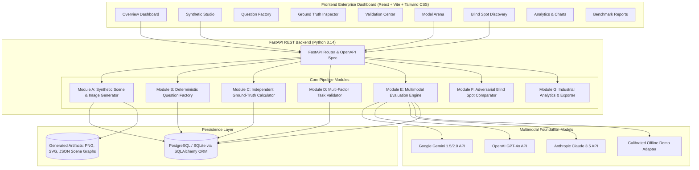

# VisionForge AI: Architecture & Implementation Plan
## Synthetic Visual Intelligence & Multimodal Benchmark Factory

**Project Codename:** VisionForge AI  
**Domain:** Manufacturing Quality Inspection & Assembly Workstations  
**Document Version:** 1.0.0  

---

## 1. Executive Summary & Problem Formulation

### 1.1 The Real-World Application Domain
In high-precision manufacturing—such as aerospace machining, automotive sub-assembly, electronics packaging, and industrial robotics—visual inspection is the first and most critical defense against catastrophic system failure:
- A missing retaining bolt on an industrial engine mount leads to structural fatigue.
- An inverted electrical connector shorts high-voltage battery modules.
- A misaligned spur gear causes gear tooth shear and transmission lockup.
- Metal shavings or tool clutter in assembly fixtures cause mechanical binding.

### 1.2 Why Multimodal AI Evaluation Needs Synthetic Benchmarks
Evaluating frontier multimodal foundation models (Gemini 1.5/2.0, GPT-4o, Claude 3.5 Sonnet) on real-world manufacturing photos faces critical bottlenecks:
1. **Lack of Verifiable Ground Truth:** Human labelers disagree on millimeter-level displacements, occlusions, and subtle 15° orientation shifts.
2. **Data Leakage & Contamination:** Web-scraped photos frequently leak into frontier model pre-training corpora.
3. **Impossibility of Controlled Adversarial Perturbations:** Real factory lines cannot reliably create 1,000 paired image variations where exactly one bolt is loosened by 2mm or lighting is dimmed by 25%.
4. **Circularity Risk:** Using LLMs to both generate the reference answers and grade model responses creates hallucinations and circular confirmation bias.

### 1.3 VisionForge Solution: The Visual Task Factory
VisionForge AI solves this by establishing an end-to-end, deterministic synthetic benchmark factory:
```
Parametric Scene Generator
          ↓
Precise Scene Graph (Geometry, Components, Defect State)
          ↓
Deterministic 2D/3D Rendering Engine (SVG + Pillow with Lighting, Noise & Specular Simulation)
          ↓
Deterministic Ground-Truth & Question Engine (Template-based, Zero LLM in Reference Truth)
          ↓
Rigorous Automated Task Validation Engine (Visual Evidence Verification, Pass/Fail Gating)
          ↓
Pluggable Multimodal Model Evaluators (Gemini, OpenAI, Anthropic, Demo Adapter)
          ↓
Adversarial Blind Spot Discovery (Controlled Delta-Pair Testing)
          ↓
Industrial Benchmark Analytics & Exportable Reports
```

---

## 2. System Architecture



---

## 3. Data Schemas & Contracts

### 3.1 Scene Graph Schema (`SceneGraph`)
Each synthetic image is generated from a strict, mathematically defined scene graph before rendering:
```json
{
  "scene_id": "sc_7f9a2b",
  "dataset_id": "ds_mfg_01",
  "seed": 4242,
  "difficulty": "medium",
  "dimensions": { "width": 800, "height": 600 },
  "workstation": {
    "fixture_type": "optical_breadboard_grid",
    "surface_color": "#1e293b",
    "lighting": {
      "ambient": 0.75,
      "direction": "top_left",
      "shadows_enabled": true,
      "specular_highlights": true
    }
  },
  "components": [
    {
      "id": "comp_gear_01",
      "type": "spur_gear",
      "name": "Drive Spur Gear 40T",
      "center": { "x": 280, "y": 320 },
      "dimensions": { "width": 120, "height": 120, "radius": 60 },
      "bbox": [220, 260, 340, 380],
      "rotation_deg": 45,
      "color": "#94a3b8",
      "expected_position": { "x": 280, "y": 320, "rotation_deg": 45 },
      "is_defective": false,
      "defect_type": null,
      "occlusion_ratio": 0.05,
      "visibility_score": 0.95,
      "layer": 1
    },
    {
      "id": "comp_bolt_01",
      "type": "hex_bolt",
      "name": "M8 Hex Flange Bolt",
      "center": { "x": 420, "y": 180 },
      "dimensions": { "width": 36, "height": 36, "radius": 18 },
      "bbox": [402, 162, 438, 198],
      "rotation_deg": 0,
      "color": "#cbd5e1",
      "expected_position": { "x": 420, "y": 180, "rotation_deg": 0 },
      "is_defective": true,
      "defect_type": "missing_or_misplaced",
      "occlusion_ratio": 0.0,
      "visibility_score": 1.0,
      "layer": 2
    }
  ],
  "spatial_relations": [
    {
      "subject_id": "comp_gear_01",
      "relation": "left_of",
      "object_id": "comp_bolt_01",
      "distance_px": 197.98
    }
  ]
}
```

### 3.2 Question & Benchmark Task Schema (`BenchmarkTask`)
```json
{
  "task_id": "task_q_104",
  "scene_id": "sc_7f9a2b",
  "category": "counting | anomaly_detection | spatial_reasoning | identification | relationship",
  "difficulty": "easy | medium | hard",
  "question_text": "How many hex bolts are fastened on the primary assembly fixture?",
  "ground_truth": {
    "answer": "3",
    "answer_type": "integer | boolean | category_enum | coordinate_bbox",
    "supporting_component_ids": ["comp_bolt_01", "comp_bolt_02", "comp_bolt_03"],
    "derivation_rule": "count(type='hex_bolt' AND visibility_score >= 0.40)"
  },
  "validation": {
    "status": "PASS",
    "score": 1.0,
    "checks": {
      "image_readable": true,
      "visual_evidence_sufficient": true,
      "answer_unambiguous": true,
      "ground_truth_verifiable": true
    }
  }
}
```

---

## 4. Ground-Truth Methodology & Verification Independence

1. **Deterministic Deduction:** Ground-truth reference answers are calculated exclusively through pure functional computation over the geometric and semantic scene graph metadata.
2. **Zero-LLM Authority:** Large language models are strictly barred from establishing or altering the reference truth.
3. **Visibility & Occlusion Thresholds:** An object with `visibility_score < 0.35` (e.g., covered by another plate or fixture) is explicitly filtered out of counting queries unless the question specifically tests occlusion awareness.
4. **Independent Verifier:** A separate validator module checks that every question's target components have unobstructed bounding box areas in the rendered image and that answer types strictly match the question template.

---

## 5. Automated Task Validation Engine Rules

Every generated `(Image, SceneGraph, Question, GroundTruth)` tuple must pass the 8-stage Task Validator:
1. **Image Readability Check:** Confirms the image file exists, is non-zero, and decodes to expected dimensions without corrupted channels.
2. **BBox Bounds & Area Check:** Every component bounding box must lie entirely within the canvas `[0, 0, width, height]` and have positive area.
3. **Visual Evidence Sufficiency:** Relevant components must have a minimum pixel area (> 150 px²) and adequate contrast relative to the workbench background.
4. **Answer Determinism:** Evaluates whether the ground truth is single-valued and matches the declared `answer_type`.
5. **Template Disambiguation:** Rejects vague queries in favor of precise operational queries.
6. **Duplicate Filter:** Eliminates duplicate or near-identical questions targeting the same scene coordinates.
7. **Adversarial Consistency:** For paired blind-spot images, validates that exactly the target property changed while background invariants remained constant.
8. **Pass/Fail Segregation:** Failed tasks are quarantined in a dedicated rejected task store with diagnostic error codes for auditability.

---

## 6. Implementation Roadmap (Phases 1 - 8)

| Phase | Milestone | Deliverables |
|---|---|---|
| **Phase 1** | Architecture & Project Scaffolding | Requirements doc, schema definitions, FastAPI backend structure, React frontend setup, SQLite/PostgreSQL configuration. |
| **Phase 2** | Synthetic Scene Generator & Image Renderer | Industrial components engine (gears, bolts, nuts, plates, fixtures, brackets), procedural scene generator with seeds, high-res Pillow/SVG renderer with realistic shadows, textures, defects. |
| **Phase 3** | Question Generation & Deterministic Ground Truth | 5 question categories (Identification, Counting, Spatial, Anomaly, Relationship), 3 difficulty tiers, pure metadata ground truth derivation. |
| **Phase 4** | Automated Task Validation & Unit Testing | Multi-factor validation engine, pass/fail gating, quarantine store, Pytest test suite (>20 tests covering all validation criteria). |
| **Phase 5** | Multimodal Evaluation Engine & Model Adapters | Provider-agnostic adapter framework (Gemini, OpenAI, Anthropic, calibrated Demo mode), answer normalizer, latency/cost/token tracker, metrics calculation. |
| **Phase 6** | Modern Enterprise React Dashboard | 10 high-impact screens (Overview, Synthetic Studio, Question Factory, Ground Truth, Validation Center, Model Arena, Blind Spot Discovery, Analytics, Reports, Settings) with Tailwind CSS, Lucide icons, Recharts. |
| **Phase 7** | Adversarial Blind Spot Discovery & Export Reports | Paired delta-generator, side-by-side comparator view, automated PDF/JSON benchmark report exporter. |
| **Phase 8** | Integration, Verification & Hackathon Polish | End-to-end integration test (generate 100 scenes, validate, evaluate), seed reproducibility verification, polished documentation. |
